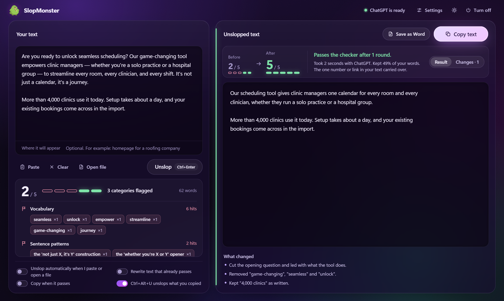
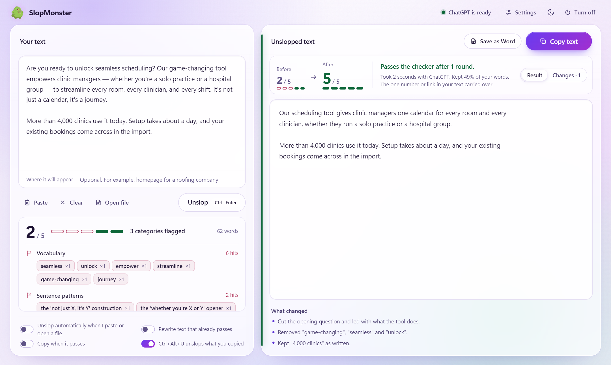
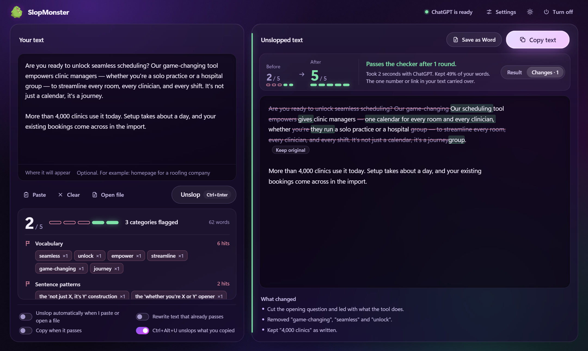
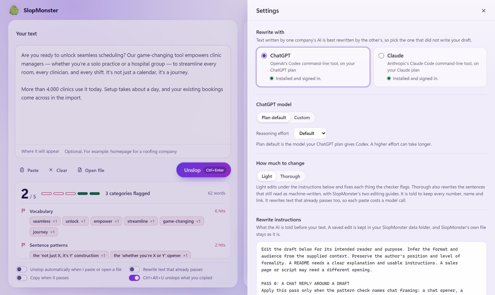

# SlopMonster GUI

SlopMonster GUI is a Windows app that scores a piece of writing for common AI writing
patterns and then has an AI rewrite it until the checker passes. It runs the Claude Code
or Codex command-line tool already signed in on your PC, so text Claude wrote can be
rewritten by ChatGPT and text ChatGPT wrote can be rewritten by Claude.



**[Download SlopMonster.exe](https://github.com/bth0mp/slopmonster-gui/releases/latest)**
for Windows 10 or 11. It needs Claude Code or the Codex CLI, signed in; see
[Requirements](#requirements).

## What it does

- **Paste, or press Ctrl+Alt+U anywhere.** Press Ctrl+V in the window and the left pane
  shows a score out of 5 with every phrase the checker flagged. Unslop sends the text for
  a rewrite, up to three rounds, and the right pane shows the result with its new score.
  From any other program, copy some text and press Ctrl+Alt+U: SlopMonster rewrites it
  and, when a Light rewrite passes and every number and link carried over, puts it back on
  the clipboard for you to paste.
- **Word and PDF files.** Open a `.docx` and Save as Word writes a copy in which only the
  words have changed. Fonts, styles, tables, images, headers and page layout stay as they
  were, and your original file is never modified. A PDF is read as text and saved as a new
  Word document. Plain `.txt` and `.md` files open too.
- **The other company's AI does the rewrite.** Choose ChatGPT (through OpenAI's Codex
  CLI) or Claude (through Claude Code) in Settings. Send Claude's drafts to ChatGPT and
  ChatGPT's drafts to Claude, so the rewrite is not a model checking its own habits. Each
  run counts against your own ChatGPT or Claude plan.
- **Light or Thorough.** Light makes small edits and fixes each thing the checker flagged.
  Thorough also goes through the text sentence by sentence and rewrites what still reads as
  machine-written, using SlopMonster's two editing guides.
- **Instructions you can edit.** Settings shows the instructions the AI gets before your
  text. Change them and save, and every run uses your copy. Reset to default brings the
  original back.
- **A Changes view.** Switch from Result to Changes to see your words struck through and
  the new ones highlighted. Keep original puts one paragraph back as you wrote it.
- **Checks before you copy.** Under the result, SlopMonster lists any number, link, email
  address or `[placeholder]` that differs between your text and the rewrite, so a changed
  price or a dropped link is easy to spot.
- **A dark theme and a light one.** The button beside Settings switches between them.



<table>
  <tr>
    <td></td>
    <td></td>
  </tr>
  <tr>
    <td align="center">The Changes view</td>
    <td align="center">Settings</td>
  </tr>
</table>

## Download

Get `SlopMonster.exe` from the
[latest release](https://github.com/bth0mp/slopmonster-gui/releases/latest). There is no
installer: the file is the app, about 12 MB. Put it in a folder where it can stay, such as
`%LOCALAPPDATA%\Programs\SlopMonster`, because a shortcut stops working when the file
moves.

Each release also has `SHA256SUMS.txt`. To check your download, run this in PowerShell in
the folder that holds the exe and compare the result with the line in that file:

```powershell
(Get-FileHash .\SlopMonster.exe -Algorithm SHA256).Hash.ToLower()
```

### "Windows protected your PC"

The exe is not code-signed, so the first time you open it Windows SmartScreen shows a blue
window saying it prevented an unrecognized app from starting. Press **More info**, check
that the file name is `SlopMonster.exe`, then press **Run anyway**. Windows remembers the
choice for that file. Your browser may also say the file is not commonly downloaded. In
Edge, open the download's menu and choose **Keep**, then **Keep anyway**.

If you would rather not run an unsigned download, check its SHA-256 as above, or
[build it yourself](#build-from-source).

## Requirements

- Windows 10 or 11.
- Chrome or Edge, for the app window. Without either, SlopMonster opens in a tab of your
  default browser and Ctrl+Alt+U is not available.
- At least one of these two command-line tools. Install it, then sign in:
  - [Claude Code](https://code.claude.com/docs/en/setup), to rewrite with Claude. In
    PowerShell: `irm https://claude.ai/install.ps1 | iex`, or
    `winget install Anthropic.ClaudeCode`. SlopMonster finds `claude.exe` where either
    one puts it, so sign in with its Sign in to Claude button. The PowerShell installer
    does not add its folder to PATH, so `claude auth login` in a terminal works only
    after you add `%USERPROFILE%\.local\bin` to PATH yourself. SlopMonster cannot run the
    npm copy of Claude Code (`claude.cmd`).
  - OpenAI's [Codex CLI](https://github.com/openai/codex), to rewrite with ChatGPT:
    `npm install -g @openai/codex`, which needs [Node.js](https://nodejs.org/), then
    `codex login` and choose to sign in with ChatGPT.

SlopMonster includes neither tool. It runs the copy on your PC, under your account, and
never sees your password. Settings also has Sign in to Claude and Sign in to ChatGPT
buttons, which open the tool's own sign-in in a console window and your browser. Being
signed in to the Claude or ChatGPT desktop app does not sign the command-line tool in.

## Quick start

1. Install Claude Code, the Codex CLI or both, and sign in.
2. Download `SlopMonster.exe` and open it. Right-click it and choose **Pin to Start** to
   keep it handy.
3. The pill at the top of the window names the AI that will do the rewrite. Open Settings
   to switch it.
4. Paste a draft with Ctrl+V and press **Unslop**, or Ctrl+Enter.
5. Read the result and the notes under it, then press **Copy text**, or **Save as Word**
   for a file.
6. **Turn off**, or closing the window, stops SlopMonster.

The full guide, including every switch and how Word files are handled, is in
[app/README.md](app/README.md).

## Privacy

- The score comes from `tools/deslop.py`, which runs on your PC. Checking text sends
  nothing anywhere.
- A rewrite sends your text and the rewrite instructions to OpenAI through the Codex CLI,
  with Codex's shell, web search and other tools switched off, or to Anthropic through
  Claude Code. It goes under your account, and each provider's own terms apply. The app
  sends your text nowhere else, and the page loads nothing from the internet.
- The app is a small server that listens only on `127.0.0.1` and answers only the page it
  served.
- Your settings, saved instructions, log and the app window's browser profile are in
  `%LOCALAPPDATA%\SlopMonster`. The log records what happened on each run, such as the
  model, rounds and scores, but never your text. Results are kept in memory only and are
  gone when you turn SlopMonster off.
- The clipboard is read when you press Ctrl+Alt+U, and written only when a rewrite passes
  and the clipboard still holds the text you copied.

## Build from source

Running from source needs Python 3.9 or newer on Windows, and `pypdf` for PDFs:

```powershell
git clone https://github.com/bth0mp/slopmonster-gui
cd slopmonster-gui
python -m pip install pypdf
powershell -ExecutionPolicy Bypass -File app\make-shortcut.ps1
```

The script puts a SlopMonster shortcut on the Desktop and in the Start Menu, which starts
`app\server.py` with no console window.

To build `SlopMonster.exe` yourself:

```powershell
python -m pip install -r packaging\requirements-build.txt
powershell -ExecutionPolicy Bypass -File packaging\build.ps1
python packaging\smoke_exe.py dist\SlopMonster.exe
```

The exe is written to `dist\`. [packaging/README.md](packaging/README.md) explains what
goes into it and how a tagged release is built on GitHub Actions. The app's tests use a
stand-in for both AIs and make no model calls:

```powershell
python app\test_server.py
python app\test_documents.py
python app\test_wordfile.py
python app\test_page.py
```

## The checker and the agent skill

The scoring comes from SlopMonster's command-line checker, which also works on its own:

```bash
python tools/deslop.py README.md
python tools/deslop.py --text "Some copy to check"
```

It reports matches in five categories (vocabulary, sentence patterns, punctuation,
three-item lists and unsupported proof) and exits with status 1 below 5/5, so it can run
in CI. [docs/SLOPMONSTER.md](docs/SLOPMONSTER.md) documents the checker, the editing
workflow and the agent skill in [SKILL.md](SKILL.md).

## Credits and license

SlopMonster GUI is built on [SlopMonster](https://github.com/ItsssssJack/SlopMonster) by
Jack Roberts ([ItsssssJack](https://github.com/ItsssssJack)). The checker, the rewrite prompt, the editing guides, the agent skill and the
mascot come from that project, under the MIT license. This fork adds the Windows app and
rules for wording that a chat reply puts around a draft. The whole repository is under the
[MIT license](LICENSE), which keeps the original copyright notice.

SlopMonster GUI is not affiliated with Anthropic or OpenAI. Claude and Claude Code are
trademarks of Anthropic. ChatGPT and Codex are trademarks of OpenAI.
